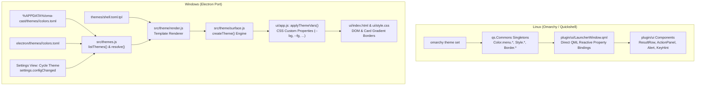

# oma-cast Theme Specification

**Status:** Canonical Spec  
**Target Platforms:** Linux (`omarchy-shell` / Quickshell QML plugin) and Windows (Electron standalone port)  
**Related Documents:** [`SPEC.md`](../SPEC.md) (§2.0, §10.4), [`CLAUDE.md`](../CLAUDE.md), [`reference/04-frontend-features.md`](../reference/04-frontend-features.md) (§4)

---

## 1. Overview & Philosophy

`oma-cast` is designed to feel like an inseparable part of the host environment rather than an alien electron/web utility. Its theming model is built on four core tenets:

1. **Zero-Configuration Native Look (Linux):** On Omarchy, the launcher has no bespoke theme configuration file or separate theme daemon. It binds directly to Omarchy's live singletons (`qs.Commons.Color.menu.*`, `qs.Commons.Style.*`, and `qs.Commons.Border.*`). When the user switches themes via `omarchy theme set <theme>`, `oma-cast` restyles instantly in memory with zero process restarts and zero parsing overhead.
2. **Pixel-Faithful Cross-Platform Engine (Windows):** The Windows port reproduces Omarchy's theme compilation pipeline in pure JavaScript. It parses Omarchy `colors.toml` palettes, renders `shell.toml.tpl` templates using the exact awk-compatible rounding and gradient interpolation functions, and feeds equivalent tokens to the DOM.
3. **High-Contrast Keyboard Ergonomics:** Inspired by Raycast 2.x, the UI uses distinct visual hierarchies for root queries, argument pills, selection cursor highlights, accessory badges, and action panels, ensuring unambiguous legibility at a glance.
4. **Unified Token Abstraction:** Both QML and Electron renderer implementations consume identical semantic design tokens (`background`, `foreground`, `accent`, `selectedBackground`, `selectedText`, `borderSpec`, `cornerRadius`, `gapsOut`, and typographic scales).

---

## 2. Architecture & Data Flow



### 2.1 Linux Architecture (Omarchy / Quickshell Plugin)

Under Omarchy, `oma-cast` runs in-process inside `omarchy-shell` (Quickshell).

* **Binding Target:** `LauncherWindow.qml` binds its `look` property directly:
  ```qml
  readonly property var look: ({
    background: Commons.Color.menu.background,
    foreground: Commons.Color.menu.text,
    accent: Commons.Color.menu.selectedText,
    selectedBackground: Commons.Color.menu.selectedBackground,
    fontFamily: Style.font.menuFamily
  })
  readonly property var borderSpec: Border.surfaceSpec(
    "menu", "border", Commons.Color.menu.border, Math.max(1, Style.space(2))
  )
  ```
* **Eventless Reactivity:** Because Qt Quick dynamically tracks property dependencies, changes in Omarchy's `Color` or `Style` singletons immediately trigger layout and paint updates in `oma-cast` without requiring any IPC notifications, polling, or file watches.
* **Border Surfaces:** Borders are resolved through `qs.Commons.Border.surfaceSpec`, which supports single-color borders or multi-stop Hyprland-derived gradients.

### 2.2 Windows Architecture (Electron Port)

On Windows, `oma-cast` operates as a standalone Electron desktop application that emulates the Omarchy theme system:

* **Theme Discovery (`src/themes.js`):** Inspects two roots:
  1. Bundled: `<app_root>/themes/<name>/colors.toml` (defaults to `tokyo-night`).
  2. User: `%APPDATA%\oma-cast\themes\<name>\colors.toml`.
* **Palette Compilation (`src/theme/color.js`):** Parses `colors.toml`, resolves legacy aliases (`bg` → `background`, `color0`..`color15`), calculates derived shades (`dark_background`, `lighter_background`), and handles color mixing via `mixColor()`.
* **Template Rendering (`src/theme/render.js`):** Renders `shell.toml.tpl` against the resolved palette, evaluating value replacements (`{{ key }}`), mix functions (`{{ mix start end amount }}`), and gradient functions (`{{ shell_gradient ... }}`).
* **Surface Model (`src/theme/surface.js`):** Exposes `createTheme(opts)` which constructs the JavaScript equivalents of `Commons.Color.menu.*`, `Style.space()`, `Style.font()`, and `Border.surfaceSpec`.
* **Renderer Injection (`ui/app.js`):**
  - Invokes `applyThemeVars()` to publish CSS variables onto `:root`.
  - Computes card geometry and native vs. gradient borders (`#card.gradient-border`).
  - Listens for `settings.configChanged` to recompile and repaint when the user cycles themes.

---

## 3. Theme File Formats & Schemas

A theme in `oma-cast` is defined by a directory containing at minimum a `colors.toml` file, with an optional override `shell.toml`.

```
<theme-name>/
├── colors.toml      # Required: color definitions & metadata
└── shell.toml       # Optional: complete surface & style overrides
```

### 3.1 `colors.toml` Specification

`colors.toml` is a flat TOML file containing raw hex strings or color aliases.

#### 3.1.1 Mode & Metadata
```toml
mode = "dark" # "dark" | "light"
```

#### 3.1.2 Core Foundation Palette
| Key | Type | Description | Fallback / Derived Rule |
|---|---|---|---|
| `background` | Hex (`#rrggbb`) | Primary canvas & card surface | Falls back to `color0` or `bg` |
| `dark_background` | Hex | Slightly darkened background | `mixColor(background, "#000000", "25%")` |
| `darker_background`| Hex | Deepest background / scrim | `mixColor(background, "#000000", "50%")` |
| `lighter_background`| Hex | Elevated surface / card fill | `color0` or `background` |
| `foreground` | Hex | Primary readable text | Falls back to `color7` or `fg` |
| `dark_foreground` | Hex | Secondary / muted text | Falls back to `color8` or `foreground` |
| `light_foreground` | Hex | Highlighted / bright text | `color7` or `foreground` |
| `bright_foreground`| Hex | High-emphasis glyphs & active text | `color15` or `foreground` |
| `accent` | Hex | Selection indicator, caret, focus | `color4` or `foreground` |
| `selection` | Hex | Active row background highlight | `selection_background` or `color8` |
| `selection_foreground` | Hex | Foreground text over selection | `bright_foreground` |
| `muted` | Hex | Placeholders & passive accessories | `color8` or `dark_foreground` |
| `cursor` | Hex | Caret color | `bright_foreground` |

#### 3.1.3 ANSI 16-Color Palette
Themes define base and bright ANSI colors used by syntax highlighters, calculator results, and status indicators:
* `red`, `green`, `yellow`, `blue`, `magenta`, `cyan`, `orange`, `brown`
* `bright_red`, `bright_green`, `bright_yellow`, `bright_blue`, `bright_magenta`, `bright_cyan`

#### 3.1.4 Color Mixing Arithmetic
When shades are derived or interpolated via `mixColor(start, end, amount)`, the calculation rounds using awk-compatible integer truncation:
$$\text{component} = \left\lfloor x \cdot (1 - a) + y \cdot a + 0.5 \right\rfloor$$
where $a \in [0.0, 1.0]$. This guarantees bit-for-bit parity between the Linux shell's bash/awk scripts and the Electron JavaScript engine.

---

### 3.2 `shell.toml` & `shell.toml.tpl` Specification

`shell.toml.tpl` configures how palette colors map to Omarchy's UI surfaces. When a custom `shell.toml` is present in a theme folder, it replaces the rendered template.

#### 3.2.1 Section `[menu]` (Launcher Card & Overlays)
These tokens directly govern `oma-cast`:

```toml
[menu]
# Card background fill and opacity (0.0 to 1.0)
background                = "{{ background }}"
background-alpha          = 1.0

# Base text color
text                      = "{{ foreground }}"

# Card border spec (solid hex or gradient token)
border                    = "hyprland.active-border-foreground"
border-alpha              = 1.0

# Fullscreen backdrop scrim behind the launcher card
scrim                     = "{{ background }}"
scrim-alpha               = 0.5

# Selected item background tint and opacity
selected-background       = "{{ foreground }}"
selected-background-alpha = 0.08

# Selected item text / accent color
selected-text             = "{{ accent }}"

# Border highlight on selected rows (if enabled)
selected-border           = "hyprland.active-border-foreground"
selected-border-alpha     = 0.25
```

#### 3.2.2 Section `[controls]`
Defines interactive component chrome (input fields, action panel items, argument pills):
* `normal-color`, `normal-fill-alpha` (default: 0.04), `normal-border-alpha` (default: 0.4)
* `hover-cursor-color`, `hover-cursor-fill-alpha` (default: 0.08)
* `focus-color`, `focus-fill-alpha` (default: 0.08)
* `selected-color`, `selected-fill-alpha` (default: 0.18)

#### 3.2.3 Section `[spacing]`
Governs layout padding, gaps, and dimensions:
* `scale`: Float multiplier (default: `1.0`).
* `scale-with-font`: Boolean (default: `true`). If enabled, spatial scaling scales proportionally with `font.base-size`.

#### 3.2.4 Section `[font]`
Typographic parameters:
* `base-size`: Integer base point size (default: `12`).
* Overrides for specific roles: `caption`, `bodySmall`, `body`, `subtitle`, `title`, `heading`, `display`.

---

### 3.3 Template Macro Engine

Template files (`.tpl`) support the following macro expressions:

| Macro | Description | Example Output |
|---|---|---|
| `{{ key }}` | Direct color lookup from palette | `#1a1b26` |
| `{{ key_strip }}` | Hex color with leading `#` stripped | `1a1b26` |
| `{{ key_rgb }}` | Comma-separated decimal RGB triplet | `26,27,38` |
| `{{ mix start end amount }}` | Blends two colors with awk rounding | `#292e42` |
| `{{ shell_gradient spec fallback }}` | Evaluates multi-stop gradient or color | `#7aa2f7 #bb9af7 45deg` |
| `{{ gradient_start spec fallback }}` | Returns the first color of a gradient spec | `#7aa2f7` |
| `{{ hypr_gradient spec fallback }}` | Emits Hyprland Lua table format | `{ colors = {"#7aa2f7"}, angle = 45 }` |

---

## 4. Semantic Token System & Scaling

`oma-cast` translates raw theme colors into semantic functional tokens.

### 4.1 Layout & Spatial Scaling

All spatial units are calculated via `Style.space(value)` and scaled by the user's `uiZoom` configuration:

```js
function effectiveSpacingScale(style) {
  var fontScale = style.scaleWithFont ? Math.max(1 / 12, style.fontBaseSize / 12) : 1.0;
  return style.spacingScale * fontScale;
}

function space(style, value) {
  if (value <= 0) return 0;
  return Math.max(1, Math.round(value * effectiveSpacingScale(style)));
}

function px(value) {
  return Math.round(theme.space(value) * zoom);
}
```

#### Window Dimensions
* **Expanded Width:** $\min(750\text{px} \times \text{zoom}, \text{screenWidth} - 2 \cdot \text{gapsOut})$
* **Expanded Height:** $\min(475\text{px} \times \text{zoom}, \text{screenHeight} - 2 \cdot \text{gapsOut})$
* **Compact Height:** Header height + border widths ($\sim 66\text{px}$)
* **Vertical Positioning ($Y$):** $\max(\text{gapsOut}, \min(\lfloor \text{screenHeight} / 4 \rfloor, \text{screenHeight} - \text{cardHeight} - \text{gapsOut}))$

---

### 4.2 Typographic Hierarchy

Font sizes are derived from `fontBaseSize` (default: 12px) using standard ratio multipliers:

| Token Name | Multiplier | Computed Size (@ 12px) | Usage in `oma-cast` |
|---|---|---|---|
| `caption` | $0.833$ | $10\text{px}$ | Key hints, accessories, badge labels |
| `bodySmall` | $0.917$ | $11\text{px}$ | Subtitles, breadcrumbs, secondary info rows |
| `body` | $1.000$ | $12\text{px}$ | Result row titles, action panel items, pill text |
| `subtitle` | $1.083$ | $13\text{px}$ | Section headers, toast body text |
| `title` | $1.167$ | $14\text{px}$ | Dialog titles, alert titles |
| `heading` | $1.333$ | $16\text{px}$ | Search query input text ($1.15 \times \text{heading}$), calculator output |
| `display` | $2.000$ | $24\text{px}$ | Empty state glyphs, hero icons |

#### Font Stacks
* **Icon & Logo Font:** `omarchy.ttf` (provides brand glyphs such as Omarchy `\uE900`).
* **Monospace & Icons:** `JetBrainsMono Nerd Font` (provides symbols `\uF0xx`, `\uF06A9`, etc.).
* **UI Typography:** Set via `Style.font.menuFamily` or overridden by `config.fontFamily`.

---

### 4.3 Border Specifications (`Border.surfaceSpec`)

Borders are resolved through a structured object:

```ts
interface BorderSpec {
  widths: { top: number; right: number; bottom: number; left: number };
  color: string; // Solid CSS hex/rgba
  gradient?: {
    enabled: boolean;
    colors: string[]; // List of hex colors
    angle: number;    // Degrees
  };
}
```

* **Solid Borders:** Rendered via native CSS `border-width` and `border-color` (or QML `Rectangle { border.color; border.width }`).
* **Gradient Borders:** Rendered via a double-box background clipping mask:
  ```css
  #card.gradient-border {
    border-color: transparent;
    background: linear-gradient(var(--bg), var(--bg)) padding-box,
                var(--card-gradient) border-box;
  }
  ```

---

## 5. Component Styling & Visual Mapping

| Component | Semantic Role | Token / Value Mapping |
|---|---|---|
| **Backdrop Scrim** | Background Dimmer | `Commons.Color.menu.scrim` with `scrim-alpha` ($0.50$) |
| **Card Container** | Main Window Surface | Background: `Commons.Color.menu.background`<br>Border: `Border.surfaceSpec("menu", ...)`<br>Radius: `Math.max(Style.cornerRadius, px(8))` |
| **Search Input** | Main Query Field | Font: $1.15 \times \text{heading}$<br>Color: `Commons.Color.menu.text`<br>Caret: `Commons.Color.menu.selectedText` (530ms blink) |
| **Argument Pills** | Inline Query Args | Background: `alpha(foreground, 0.06)`<br>Focused Background: `alpha(foreground, 0.12)`<br>Border: `alpha(foreground, 0.15)`<br>Radius: `Math.max(Style.cornerRadius, px(6))` |
| **Loading Bar** | Async Progress Sweep | Height: `Style.space(2)` ($2\text{px}$)<br>Sweep Color: `Commons.Color.menu.selectedText`<br>Animation: 900ms cycle |
| **List Row (Normal)** | Unselected Item | Title: `Commons.Color.menu.text`<br>Subtitle: `alpha(foreground, 0.60)`<br>Accessories: `alpha(foreground, 0.40)` |
| **List Row (Selected)**| Active Cursor Item | Background: `Commons.Color.menu.selectedBackground`<br>Text Accent: `Commons.Color.menu.selectedText`<br>Radius: `Math.max(Style.cornerRadius, px(6))` |
| **Section Header** | Group Divider | Text: `alpha(foreground, 0.50)`<br>Font: `bodySmall`<br>Divider Line: `Style.spacing.hairline` with `alpha(foreground, 0.10)` |
| **Action Panel** | Secondary Menu (Ctrl+K) | Container: Nested card with `Math.max(Style.cornerRadius, px(8))`<br>Filter Input: `alpha(foreground, 0.06)`<br>Row Height: `px(32)` |
| **Toast / HUD** | Ephemeral Feedback | Background: Elevated `menu.background`<br>Icon: Accent color for status (info: `accent`, error: `red`) |
| **Alert Dialog** | Confirmation Modals | Destructive Button: `Commons.Color.urgent` (`red`)<br>Card Surface: High-contrast elevation with `px(10)` radius |
| **Key Hint Badges** | Keyboard Shortcuts | Background: `alpha(foreground, 0.08)`<br>Border: `alpha(foreground, 0.15)`<br>Radius: `Style.space(4)` |

---

## 6. Theme Switching & Discovery Lifecycle

### 6.1 Linux Lifecycle
1. User executes `omarchy theme set <theme-name>`.
2. Omarchy CLI compiles `<theme-name>` templates and updates shell state.
3. `omarchy-shell` updates its internal `Commons.Color` and `Commons.Style` objects.
4. `oma-cast`'s `LauncherWindow.qml` receives immediate property notifications through Qt Quick's binding graph and repaints.

### 6.2 Windows Lifecycle
1. User opens launcher settings and navigates to the **Theme** row (`setting:config:theme`).
2. Selecting the row triggers `rootSearch.performAction` with action `"open"`:
   - Queries `themes.listThemes()` across bundled and user directories.
   - Advances to the next theme in the sorted sequence.
   - Updates `config.theme` in `%APPDATA%\oma-cast\config.json`.
3. Backend broadcasts `settings.configChanged` with `{ key: "theme" }`.
4. Renderer (`ui/app.js`) catches the event:
   - Invokes `themesLib.resolve(config.theme, themeRoots)`.
   - Rebuilds the surface theme via `surface.createTheme(...)`.
   - Re-applies CSS variables via `applyThemeVars()`.
   - Updates window geometry and border gradient classes without reloading the DOM.

---

## 7. Authoring & Verification Guide: Defining and Creating a Theme

### 7.1 Theme Anatomy & Directory Layout

A theme in `oma-cast` is encapsulated in a directory named with a clean slug (e.g. `gruvbox-dark`, `catppuccin-mocha`, `rose-pine`).

```
<theme-slug>/
├── colors.toml      # [REQUIRED] Palette values, aliases, and mode
└── shell.toml       # [OPTIONAL] Structural overrides for window, menu, borders, and fonts
```

#### Where to Place Theme Directories
* **Linux (Omarchy):**
  - User themes: `~/.config/omarchy/themes/<theme-slug>/`
  - System themes: `/usr/share/omarchy/themes/<theme-slug>/`
* **Windows (Electron port):**
  - User themes: `%APPDATA%\oma-cast\themes\<theme-slug>\` (e.g. `C:\Users\<User>\AppData\Roaming\oma-cast\themes\<theme-slug>\`)
  - Bundled themes: `<appRoot>\themes\<theme-slug>\` (pre-packaged within the app install)

---

### 7.2 Defining `colors.toml`

The theme definition starts with `colors.toml`.

#### 7.2.1 Minimal Theme Example
If you only supply the core keys, `oma-cast`'s shade generator automatically derives the remaining shades (dark background, lighter background, cursor, and selection):

```toml
mode = "dark"

background = "#1e1e2e"
foreground = "#cdd6f4"
accent     = "#cba6f7"
selection  = "#313244"
muted      = "#6c7086"

red        = "#f38ba8"
green      = "#a6e3a1"
yellow     = "#f9e2af"
blue       = "#89b4fa"
magenta    = "#f5c2e7"
cyan       = "#94e2d5"
orange     = "#fab387"
```

#### 7.2.2 Full Theme Definition Reference
For full visual control, explicitly define all foundation keys, derived shades, and ANSI pairs:

```toml
mode = "dark" # or "light"

# Foundation Colors
background         = "#1a1b26" # Canvas & window background
dark_background    = "#13141c" # 25% darkened mix (used for elevation/shadows)
darker_background  = "#0e0e14" # 50% darkened mix (used for backdrop scrim)
lighter_background = "#24283b" # Elevated surfaces / card backgrounds

foreground         = "#a9b1d6" # Base text color
dark_foreground    = "#565f89" # Secondary text / inactive labels
light_foreground   = "#b4bee6" # High-contrast body text
bright_foreground  = "#c0caf5" # Headers, bold titles, caret cursor

# Functional Accents
accent               = "#7aa2f7" # Caret, active badges, focus indicators
selection            = "#292e42" # Selected list item background
selection_background = "#292e42" # Alias for selection
selection_foreground = "#c0caf5" # Foreground text when item is selected
muted                = "#414868" # Placeholders, key hint outlines, icons
cursor               = "#c0caf5" # Text input caret glyph

# Standard Palette
red     = "#f7768e" # Errors, destructive alerts (Kill Process, Delete)
orange  = "#eb927b" # Warnings, secondary indicators
yellow  = "#e0af68" # Calculator results, tags
green   = "#9ece6a" # Success indicators, confirmations
blue    = "#7aa2f7" # Links, primary metadata
cyan    = "#449dab" # Quicklink pills, accessory tags
magenta = "#ad8ee6" # Extension badges, aliases
brown   = "#75493d"

# Bright ANSI Palette (optional, defaults to standard colors)
bright_red     = "#ff7a93"
bright_green   = "#b9f27c"
bright_yellow  = "#ff9e64"
bright_blue    = "#7da6ff"
bright_magenta = "#bb9af7"
bright_cyan    = "#0db9d7"
```

---

### 7.3 Customizing UI Surfaces with `shell.toml` (Optional)

By default, `oma-cast` renders `themes/shell.toml.tpl` against `colors.toml`. If you drop a `shell.toml` into your theme directory, you can override specific surface parameters.

#### Common Surface Customizations:
```toml
[menu]
# Make launcher card translucent (0.0 to 1.0)
background-alpha = 0.92

# Custom border: can be a solid hex or a multi-color gradient with angle
border = "#7aa2f7 #bb9af7 45deg"
border-alpha = 1.0

# Customize full-screen dim behind launcher
scrim-alpha = 0.60

# Customize selected row highlight tint
selected-background-alpha = 0.12
selected-text = "{{ accent }}"

[spacing]
# Global layout scale multiplier (1.0 = standard 750x475 px card)
scale = 1.0
scale-with-font = true

[font]
# Base font point size (default 12)
base-size = 12
```

---

### 7.4 Step-by-Step: Creating a New Theme

#### On Linux (Omarchy Desktop)
1. **Create the theme folder:**
   ```bash
   mkdir -p ~/.config/omarchy/themes/monokai-pro
   ```
2. **Write `colors.toml`:**
   ```toml
   # ~/.config/omarchy/themes/monokai-pro/colors.toml
   mode = "dark"
   background = "#2d2a2e"
   foreground = "#fcfcfa"
   accent     = "#ffd866"
   selection  = "#403e41"
   muted      = "#727072"
   red        = "#ff6188"
   green      = "#a9dc76"
   yellow     = "#ffd866"
   blue       = "#78dce8"
   magenta    = "#ab9df2"
   cyan       = "#78dce8"
   orange     = "#fc9867"
   ```
3. **Activate the theme:**
   ```bash
   omarchy theme set monokai-pro
   ```
   `oma-cast` restyles immediately in memory.

---

#### On Windows (Electron)
1. **Create the user theme folder:**
   ```powershell
   New-Item -ItemType Directory -Path "$env:APPDATA\oma-cast\themes\monokai-pro" -Force
   ```
2. **Write `colors.toml`:**
   Save the TOML above to `%APPDATA%\oma-cast\themes\monokai-pro\colors.toml`.
3. **Activate the theme:**
   * **From GUI:** Press `Alt+Space` to summon `oma-cast`, press `Ctrl+,` to open the **Settings** view, navigate to the **Theme** row (`setting:config:theme`), and press `Enter` to cycle until `monokai-pro` appears.
   * **Via `config.json`:** Set `"theme": "monokai-pro"` in `%APPDATA%\oma-cast\config.json`.
   * **Via CLI:**
     ```powershell
     bin\oma-cast.ps1 call settings.setConfigValue '{"key":"theme","value":"monokai-pro"}'
     ```

---

### 7.5 Automated Verification

Whenever creating or modifying theme engines or schemas, run the test suites:

```sh
# Run shared core & backend tests
node --test tests/*.test.js

# Run Electron theme resolution & template tests
cd electron && npm test
```

Key verification assertions:
* `mixColor`: Asserts that shade mixing produces zero rounding drift against Omarchy's awk calculations.
* `renderShell`: Asserts that all `{{ ... }}` macro expressions in `shell.toml.tpl` resolve without orphaned tags.
* `createTheme`: Asserts that `borderSpec`, `menu` colors, and `font()` scales match Omarchy singletons.
* `listThemes`: Asserts that user-defined themes in `%APPDATA%` take precedence and fall back gracefully to `tokyo-night`.
